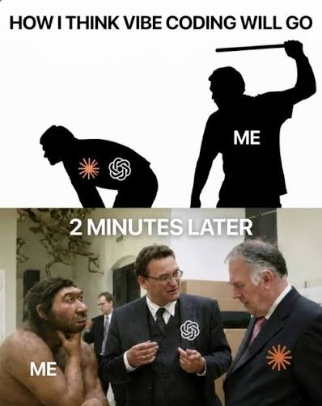
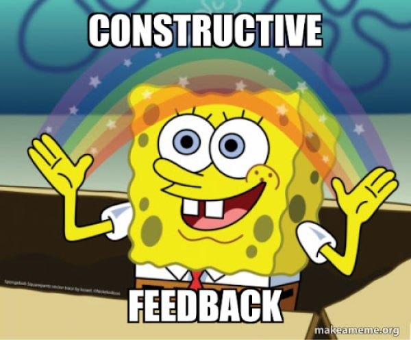

<style>
section :not(pre) > code,
section ul li code {
  display: inline;
  position: static;
  margin: 0;
  padding: 0.1em 0.35em;
  font-size: 0.9em;
  color: var(--pink-color);
  background: rgba(255, 255, 255, 0.08);
  border: none;
  border-radius: 6px;
}
section pre {
  font-size: 0.6em;
  color: white;
  background: rgba(255, 255, 255, 0.06);
  border: 1px solid rgba(255, 255, 255, 0.12);
  border-radius: 8px;
}
section pre code {
  color: inherit;
  background: none;
}
section.flat.pink h3 {
  font-size: 0.8em;
  font-weight: normal;
  font-style: italic;
  opacity: 0.85;
}
</style>
<!-- _paginate: skip -->
<!-- _footer: '' -->
<!-- _class: invert top -->


# The Vibecoder

---

## Sommaire

1. Le Vibe Coding
2. Le Workflow
3. L'Agent
4. Le Feedback
5. Conclusion

---

## Ce talk n'est pas…

- pour convaincre
- une software factory
- Ralph
- une méthode universelle

---

## …c'est plutôt

- un rex 🦖
- en chantier constant
- hyper personnalisation

---
<!-- _class: flat pink center -->
<!-- _paginate: skip -->
<!-- _footer: '' -->

# 1

## Le Vibe Coding

### Vibecoder 101



---

## Grosso modo

- tâche Asana
- repérage code vite fait
- prompt + plan
- vérification (review, check UI, etc.)

---

## Les ténèbres

- osef du plan parfois
- qualité aléatoire
- vérification inconsistante
- pas de mémoire entre plans
- personnalisation splittée entre conversations et fichiers Claude

---
<!-- _class: flat pink center -->
<!-- _paginate: skip -->
<!-- _footer: '' -->

# 2

## Le Workflow

### Trust me I'm an engineer


---

<style scoped>
p { margin-top: 60px; font-size: 1.2em; }
</style>

## Source ?

*How I manage my agents* · [Fatih Arslan](https://arslan.io/2026/09/11/how-i-manage-my-agents/)

---

<style scoped>
p:nth-of-type(1) { margin-top: 60px; font-size: 1.1em; }
</style>

## Ce que ça fait

commits | PR | tickets → skills `plan-*`

---

<style scoped>
blockquote { color: white; border-left-color: var(--pink-color); margin-top: 60px; font-size: 1.1em; }
</style>

## Extrait de mon fichier HABITS

> « Nested ternaries: corrected twice in one day. »

---

<style scoped>
pre { font-size: 0.9em; }
</style>

## Kanban 3000.0

```
plan-add         →  drafts/
grill-with-docs
plan-write       →  next/
plan-dispatch    →  open/
aro-review
plan-sync        →  done/
```

---

<style scoped>
p { margin-top: 60px; font-size: 1.1em; }
</style>

## Ma, look at my fork

`grill-with-docs` | `aro-review` | `aro-code-style` | `aro-testing`

---


- Plans autonomes
- Zéro flou
- Parallélisable
- Historique

---


- Trop lourd pour un bugfix
- Illusion de contrôle
- Le bottleneck, c'est moi
- Des skills à maintenir

---
<!-- _class: flat pink center -->
<!-- _paginate: skip -->
<!-- _footer: '' -->

# 3

## L'Agent

### C'est qui le patron ? C'est moi


---

## L'IA en fait trop ou pas assez

- **Pas assez** → naïf, générique
- **Trop** → défensif, tests inutiles

---

<style scoped>
p:nth-of-type(1) { margin-top: 60px; }
p:nth-of-type(2) { margin-top: 40px; font-size: 1.1em; }
</style>

## Transmettre son goût

Les connaissances du modèle = la moyenne

**→ injecter ses préférences dans les skills**


---

<style scoped>
blockquote { color: white; border-left-color: var(--pink-color); margin-top: 60px; font-size: 1.1em; }
section > p { color: var(--slate-color); }
section > p:last-of-type { margin-top: 50px; }
</style>

## TDD

> « Tests pin business rules… not a coverage target. »

`aro-testing`

**Red → Green → Refactor : étonnamment efficace sur un plan exécuté pas à pas** (voir slide sur les feedbacks)

---

<style scoped>
blockquote { color: white; border-left-color: var(--pink-color); margin-top: 60px; font-size: 1.1em; }
section > p { color: var(--slate-color); }
</style>

## Let it crash

> « Accept that the application will meet unexpected errors… »

`aro-code-style`

---

## Le piège

- Parfois un mot-clé suffit
- Parfois non
- Il faut expérimenter ™️

---

<style scoped>
p:nth-of-type(1) { display: flex; align-items: center; gap: 24px; margin-top: 60px; font-size: 1.1em; }
p:nth-of-type(1)::before, p:nth-of-type(1)::after { content: ""; flex: 1; border-top: 3px solid var(--pink-color); }
p:nth-of-type(1)::before { order: 2; }
p:nth-of-type(1)::after { order: 4; }
p:nth-of-type(1) strong { color: white; }
p:nth-of-type(1) strong:first-child { order: 1; }
p:nth-of-type(1) em { order: 3; font-style: normal; font-size: 1.4em; }
p:nth-of-type(1) strong:last-child { order: 5; }
</style>

## Reprendre le contrôle

**YOLO** *🎯* **micro-management**

---
<!-- _class: flat pink center -->
<!-- _paginate: skip -->
<!-- _footer: '' -->

# 4

## Le Feedback

### ~~Attention~~ Feedback is all you need



---

<style scoped>
p { margin-top: 60px; font-size: 1.1em; }
</style>

## Blinder les checks auto

Typecheck, Lint, Format, Tests unitaires, Tests d'intégration

---

## Vérifier ne doit pas être chiant

- API documentée et testable en un clic (Bruno, OpenAPI)
- Données invalides rejetées tout de suite (Zod)
- Playground (ex : preview Roleplay dans l'admin)
- Checklist manuelle (vérification UI, smoke test, etc.)

**→ l'IA lance la plupart de ces vérifs et corrige dans la foulée, même certaines manuelles**

---

<style scoped>
blockquote { color: white; border-left-color: var(--pink-color); margin-top: 60px; font-size: 1.1em; }
section > p { color: var(--slate-color); }
</style>

## Citation dropping

> « Agents are most powerful when they can validate their work against reality. »

[Amp · Feedback Loopable](https://ampcode.com/notes/feedback-loopable)

---
<!-- _class: flat pink center -->
<!-- _paginate: skip -->
<!-- _footer: '' -->

# 5

## Conclusion

### On vit dans une saucisse

---

## Avant Après

- Plan jetable → Plan versionné
- Qualité aléatoire → Préférences injectées
- Vérification inconsistante → Feedback blindé


---

## Apprendre en pratiquant

- Le code ne coûte plus rien
- **→ tester une archi hexagonale, une idée de design… en une après-midi**


---

<style scoped>
p:nth-of-type(1) { margin-top: 60px; }
p:nth-of-type(2) { margin-top: 40px; font-size: 1.2em; }
</style>

## Refocus sur les fondamentaux

craft | archi | a11y | design

→ [développer son **goût**](https://emilkowal.ski/ui/developing-taste)


---

## Votre devoir à la maison

- Tester le [prompt](https://arslan.io/2026/09/11/how-i-manage-my-agents/) de l'article
- Versionner les skills générés
- `plan-init` un projet et versionner le dépôt de plans
- Ajouter votre premier plan avec `plan-add`
- Versionner les skills les plus utilisés
- Créer des skills customs pour la review, le style de code, les pratiques de test

---

<style scoped>
p { display: flex; flex-wrap: wrap; justify-content: center; align-items: center; gap: 24px 56px; margin-top: 40px; }
p code { background: none; padding: 0; font-family: inherit; }
p code:nth-of-type(1) { font-size: 1.2em; color: var(--teal-color); transform: rotate(-4deg); }
p code:nth-of-type(2) { font-size: 1.3em; color: white; }
p code:nth-of-type(3) { font-size: 3em; color: var(--pink-color); }
p code:nth-of-type(4) { font-size: 1.2em; color: var(--teal-color); }
p code:nth-of-type(5) { font-size: 1.1em; color: var(--amber-color); transform: rotate(5deg); }
</style>

## En bref

`clarify` `custom skills` `feedback` `versioning` `experiment`

---
<!-- _class: flat pink center -->
<!-- _paginate: skip -->
<!-- _footer: '' -->

# Merci


