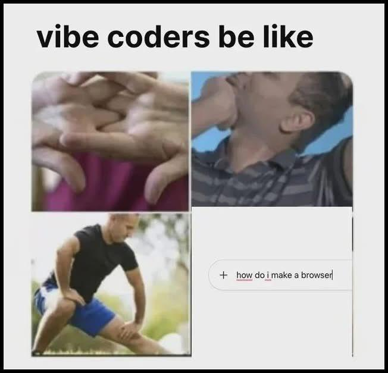

<style>
section :not(pre) > code,
section ul li code {
  display: inline;
  position: static;
  margin: 0;
  padding: 0.1em 0.35em;
  font-size: 0.9em;
  color: var(--pink-color);
  background: rgba(255, 255, 255, 0.08);
  border: none;
  border-radius: 6px;
}
section pre {
  font-size: 0.6em;
  color: white;
  background: rgba(255, 255, 255, 0.06);
  border: 1px solid rgba(255, 255, 255, 0.12);
  border-radius: 8px;
}
section pre code {
  color: inherit;
  background: none;
}
</style>
<!-- _paginate: skip -->
<!-- _footer: '' -->
<!-- _class: invert top -->


# The Vibecoder 🥀

---

## Sommaire

1. Le vibe coding YOLO
2. Mon workflow
3. Piloter l'agent
4. Les feedbacks
5. Conclusion

---

## Ce talk n'est pas…

- ~~Un pitch pour vous convertir~~
- ~~Une software factory multi-agents en autopilote~~
- ~~La dernière méthode hype~~ (Ralph)
- ~~Une recette qui marche pour tout le monde~~

---

## …c'est plutôt

- Mon REX, ma façon de bosser
- Du **software craft**, version agents LLM
  clean code | clean archi | feedback rapide | tests auto
- Une méthode taillée à mon style de dev
- Rien de figé, tout s'améliore à tâtons 🧪

---
<!-- _class: flat pink center -->
<!-- _paginate: skip -->
<!-- _footer: '' -->

# 1

## Le vibe coding YOLO

---
<!-- _class: center -->

## D'où on vient



---

## Mon process d'avant

1. Une tâche à faire
2. Claude Code dans VS Code
3. J'ouvre le fichier qui me semble concerné
4. Mode plan + prompt
5. Je relis le plan… ✅ validé
6. Je teste l'app à la main

**Même avec un plan… c'était du YOLO**

---

## Ce qui coince

- Le plan ? On finit par s'en foutre 🙈
- Qualité aléatoire : modèle | contexte trouvé | effort
- Contrôle de l'output inconstant : là où un dev fait la différence
- Des plans sans mémoire, sans historique

---
<!-- _class: flat pink center -->
<!-- _paginate: skip -->
<!-- _footer: '' -->

# 2

## Mon workflow

---

## Le déclic

> **How I manage my agents** · Fatih Arslan
> [arslan.io](https://arslan.io/2026/09/11/how-i-manage-my-agents/)

1. Trouvé par hasard en veille
2. Méfiant 🤨, lu en diagonale
3. Tout en bas : un prompt à copier-coller
4. Tester ne coûte rien, alors je teste
5. Adopté petit à petit, à ma sauce

---

## Le prompt, en bref

`git log` → mes habitudes (`HABITS.md`) → skills `plan-*` → le workflow

**Le but** : tout garder en Markdown, selon *mes* conventions

- le travail → un fichier par plan
- ce qui se dit en conversation → écrit dans le plan
- le projet → `PROJECT.md`

---

<style scoped>
blockquote { color: white; border-left-color: var(--pink-color); }
</style>

## Extrait de `HABITS.md`

*Mistakes corrected more than once*

> « Nested ternaries: corrected twice in one day. »

→ l'agent le relit à chaque session, je ne corrige plus

---

## Le dépôt de plans

Un repo git par projet, à côté du code, ex. `roleplay-plans`

```
roleplay-plans/
├── drafts/   idées, questions ouvertes
├── next/     tout est décidé, prêt à lancer
├── open/     un agent bosse dessus
└── done/     tout est mergé
```

---

<style scoped>
pre { font-size: 0.85em; }
p { text-align: center; margin-top: 30px; font-size: 0.6em; color: var(--slate-color); }
</style>

## La vie d'un plan

```
plan-add         →  drafts/
grill-with-docs     on lève le flou
plan-write       →  next/
plan-dispatch    →  open/
aro-review          code review systématique
plan-sync        →  done/
```

`plan-init` au setup | `plan-status` à tout moment | `plan-retro` tous les 15 jours | `plan-spec` la convention

Skills adoptés de [mattpocock/skills](https://github.com/mattpocock/skills) : `grill-with-docs`, `domain-modeling`…

---

## Ma personnalisation

- `grill-with-docs` avant `plan-write` : lever le flou
- `aro-review` à la fin de chaque dispatch
- `aro-code-style` et `aro-testing` : mes préférences, chargées par les `plan-*`

---

## 👍 Ce qui est cool

- Des plans autonomes, qui contiennent tout pour mener la tâche
- Plus de flou, ni technique ni produit
- Plans indépendants → parallélisation (`git worktree`)

---

## ⚠️ À surveiller

- Surdimensionné pour un petit bugfix
- Un plan bien écrit ≠ du code de qualité : gare à l'illusion de contrôle
- Le bottleneck, c'est moi : review et context switching
- Des skills à faire évoluer et à maintenir

---
<!-- _class: flat pink center -->
<!-- _paginate: skip -->
<!-- _footer: '' -->

# 3

## Piloter l'agent

---

## Le plus dur : piloter finement

L'agent en fait trop… ou pas assez

- **Pas assez** → implémentation naïve
- **Pas assez** → des UI génériques, pas craftées
- **Trop** → programmation ultra défensive
- **Trop** → des tests qui ne servent à rien

---

<style scoped>
blockquote { color: white; border-left-color: var(--pink-color); }
</style>

## Distiller ses goûts

Sans consignes, le modèle livre la moyenne, misconceptions comprises

> Mes préférences → des skills, et des docs si besoin

---

<style scoped>
blockquote { color: white; border-left-color: var(--pink-color); }
</style>

## Exemple : le TDD

Défini dans `aro-testing`

- ce qu'est *pour moi* un test unitaire
- red → green → **refactor**
- le design qui émerge des tests

> « Tests pin business rules. They are a design tool driven by the spec, not a coverage target. »

---

<style scoped>
blockquote { color: white; border-left-color: var(--pink-color); }
</style>

## Exemple : let it crash

Défini dans `aro-code-style`

> « Accept that the application will meet unexpected errors, and design it to recover rather than trying to prevent every bug with defensive checks. »

---

## ⚠️ Le piège : tout sur-spécifier

- Parfois, une phrase ou le bon mot-clé suffit
- Parfois, il faut être explicite
- Pas de règle : il faut beaucoup tester 🧪

---

<style scoped>
p { text-align: center; }
p:nth-of-type(1) { margin-top: 50px; font-size: 1.1em; }
p:nth-of-type(2) { margin-top: 40px; }
p:nth-of-type(3) { margin-top: 30px; color: var(--slate-color); }
</style>

## Reprendre le contrôle

YOLO ←—— 🎯 ——→ micro-management

Le contrôle sur la façon de construire le produit, pas sur chaque ligne

Trop micro-manager l'IA, c'est perdre son intérêt

---
<!-- _class: flat pink center -->
<!-- _paginate: skip -->
<!-- _footer: '' -->

# 4

## Les feedbacks

---

## Ma take : blinder le feedback

Des méthodes éprouvées, d'avant les LLM… devenues faciles à mettre en place

1. **Statique** : lint, format, typecheck, tests
2. **Validation** : Zod partout, l'OpenAPI en découle
3. **API** : Bruno, lancé par l'agent
4. **Manuel** : checklists comme les pilotes d'avion ✈️, smoke test du parcours principal

---

<style scoped>
p { text-align: center; }
p:nth-of-type(1) { margin-top: 60px; font-size: 1.1em; }
p:nth-of-type(2) { margin-top: 50px; font-size: 1.2em; }
</style>

## Vérifier ne doit pas être chiant

Je ne relis plus ligne à ligne → je vérifie le résultat, vite

**Si vérifier est pénible, on ne vérifie plus**

---

<style scoped>
p { text-align: center; }
p:nth-of-type(1) { margin-top: 20px; }
p:nth-of-type(2) { margin-top: 50px; color: var(--slate-color); }
p:nth-of-type(3), p:nth-of-type(4) { margin-top: 20px; font-size: 1.1em; }
</style>

## Le playground

Un raccourci pour tester l'app sans se taper tout le flow

Avant : `ContentStudio` → `ContentPlayer web` → enfin le roleplay 😮‍💨

UI : `admin` → `preview chat` ⚡

API : `Bruno` → requête prête, auth incluse ⚡

---

<style scoped>
blockquote { color: white; border-left-color: var(--pink-color); }
</style>

## Une idée qui circule

- **Storybook** : un « frontend workshop », l'UI en isolation
- **Home Assistant** : un *dev playground*, en debug, via un raccourci
- **Amp** · *Feedback Loopable* :

> « Agents are most powerful when they can validate their work against reality. »

---
<!-- _class: flat pink center -->
<!-- _paginate: skip -->
<!-- _footer: '' -->

# 5

## Conclusion

---

## Ce qui coince → la réponse

- Le plan, on s'en fout → un plan versionné, qui sert
- Qualité aléatoire → mes goûts dans des skills
- Contrôle inconstant → des feedbacks blindés
- Pas de mémoire → `HABITS.md` + dépôt de plans

---

## On refait de l'ingénierie

- Le code devient une commodité
- Le moment de blinder les fondamentaux
- L'agent m'accompagne… ou je l'accompagne

---

<style scoped>
p { text-align: center; margin-top: 50px; }
p code { font-size: 1.2em; }
</style>

## Où je mets mon énergie

`software craft` | `archi` | `accessibilité` | `design`

… et tout simplement développer mon **goût**

---

<style scoped>
blockquote { color: white; border-left-color: var(--pink-color); font-size: 1.2em; }
</style>

## Pas que moi

> « Simply shipping a product that works is no longer enough. »

Emil Kowalski · [*Developing Taste*](https://emilkowal.ski/ui/developing-taste)

---

## À vous de jouer

1. Lancer le prompt d'Arslan sur un de vos repos
2. Versionner ce qu'il génère : skills et dépôt de plans
3. Un playground ou une checklist de smoke test sur votre projet

---
<!-- _class: flat pink center -->
<!-- _paginate: skip -->
<!-- _footer: '' -->

# Merci 🥀

## Questions ?
